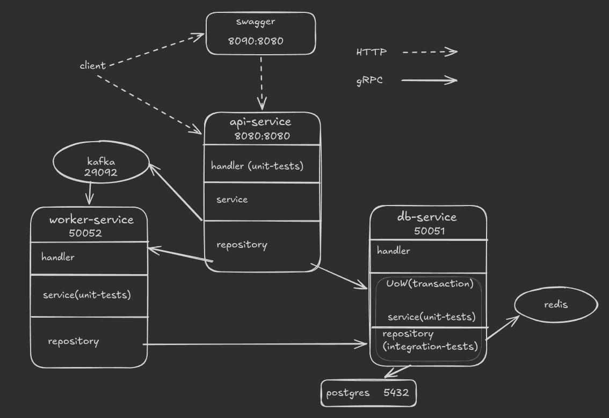

# Alchemical Laboratory
## a potion-brewing system

> Looking back later: [Retrospective](#retrospective)

## Architecture



- **api-service** — HTTP API (`:8080`). Talks to db-service over gRPC and publishes brewing jobs to Kafka.
- **db-service** — gRPC service (`:50051`) that owns PostgreSQL and the Redis recipe cache.
- **worker-service** — Kafka consumer that brews potions in a worker pool.

## How brewing works

1. `POST /brew` — api-service creates a job (`queued`) in db-service and publishes it to Kafka (`brew-jobs`). Returns `202 Accepted` with `job_uuid`.
2. worker-service consumes the message and processes it in a worker pool (`WORKER_POOL_SIZE`).
3. db-service moves the job `queued → brewing` and deducts the ingredients in one transaction.
4. The worker waits for the recipe's brewing time and moves the job `brewing → completed`.
5. `GET /brew/status?uuid=<job_uuid>` returns the current status.

### Job lifecycle

```
queued ───────→ brewing ───────→ completed
   │               │
   └───→ failed ←──┘
```

Transitions are guarded in SQL (`UPDATE ... WHERE status = ANY(allowed)`), so an invalid one (for example `completed → failed`) is rejected.

### Reliability

- **At-least-once delivery.** Offsets are committed only after every message in a batch is processed or handed off to retry/DLQ. If handing off fails, the batch is not committed and the worker exits so it can be restarted.
- **Idempotent processing.** A redelivered message never deducts ingredients twice.
- **Interrupted brewing.** If a worker dies mid-brew, the redelivered message waits until the brew should have finished and then marks the job `failed`, unless the original worker completed it.
- **Retry with backoff.** Technical errors go to `brew-jobs.retry` with growing delays (5s → 30s → 2m), then to `brew-jobs.dlq`.
- **Business errors don't retry.** Not enough ingredients → the job is `failed` immediately.
- **Graceful shutdown.** On `SIGTERM` the worker stops, the unfinished batch is not committed and will be redelivered.

## Tech Stack
- Go 1.25.7
- PostgreSQL 17
- Docker / docker-compose
- sqlx, testcontainers-go, testify, mockery
- gRPC
- Redis
- Kafka (franz-go)
- Prometheus + Grafana

## How to run
```
make init      # create .env files from .env.example
make up        # build and start everything
```

Configuration comes from the `.env` files through `env_file` in docker-compose; they are not copied into the images.

## Local URLs

| Service    | URL                   |
|------------|-----------------------|
| Base URL   | http://localhost:8080 |
| Swagger UI | http://localhost:8090 |
| Grafana    | http://localhost:3000 |
| Prometheus | http://localhost:9099 |

## API Endpoints
- POST  /ingredients
- GET   /ingredients
- PATCH /ingredients/{id}
- POST  /recipes
- GET   /recipes
- POST  /brew
- GET   /brew/status?uuid=<job_uuid>   → `{"status": "queued | brewing | completed | failed"}`

## Testing

```
make test                # all tests
make test-unit           # unit tests
make test-integration    # integration tests (testcontainers)
make test-cover          # run with coverage report
make test-cover-html     # run with coverage report in html
```

## Roadmap
- [x] Monolith — single service, single database
- [x] Divide into microservices (api / db / worker)
- [x] Unit and integration tests
- [x] Docker containerization + graceful shutdown
- [x] Swagger documentation
- [x] HTTP → gRPC between services
- [x] Redis caching for recipes
- [x] Kafka for async worker jobs
- [x] Kafka retry + DLQ
- [x] gRPC health checks
- [x] Worker pool + shutdown without message loss
- [x] Retry with backoff
- [x] Job state machine + idempotent processing

## Extra tasks
- [x] Structured logging (slog)
- [x] Prometheus + Grafana metrics
- [x] Test coverage ≥ 60%
- [x] CI/CD pipeline (GitHub Actions) (only CI)
- [x] Stress tests (k6)

## Known limitations
- api-service writes the job to the database and then publishes it to Kafka. If Kafka is down at that moment, the job stays `queued`. Fix: Transactional Outbox, or mark the job `failed` when publishing fails.
- Retry messages are waited out inside the shared worker pool, so many retries at once can delay new jobs. Fix: a separate consumer for `brew-jobs.retry`.
- A worker that dies mid-brew loses that brew: the job becomes `failed` and the ingredients are not returned. Fix: leases with heartbeats, so another worker can take over the job.

## Retrospective

Looking back, this is a distributed monolith rather than microservices:
- db-service is a gRPC wrapper over the database. Almost every api-service request is a synchronous call to it, so neither can work without the other.
- All services share one Go module (`shared/`) with DTOs, errors and statuses, so a change in one service often means rebuilding and redeploying all of them.
- None of the services can be deployed or scaled on its own in a meaningful way.

What I would do differently:
- At the very least, merge api-service and db-service: the extra network hop adds latency and failure modes without giving anything back.
- More likely, merge everything into one service. The workload is small, and Kafka is overkill for it.
- Use PostgreSQL as the job queue: workers take jobs with `SELECT ... FOR UPDATE SKIP LOCKED` and are woken up with `LISTEN/NOTIFY` instead of polling. Creating a job and enqueuing it then becomes a single transaction, which also removes the first known limitation (no Outbox needed).
